# ERD dan Database Dictionary — MySQL

## 1. Prinsip model data

- Dasar entitas dari Bab 11 BRD; detail field/normalisasi tambahan pada dokumen ini adalah **[REKOMENDASI]**.
- Gunakan MySQL/InnoDB, PK `BIGINT UNSIGNED` (`id`) atau UUID/ULID konsisten per domain (pilih saat bootstrap, jangan mencampur sembarang). `created_at`, `updated_at`, `created_by`/`updated_by` bila relevan.
- Setiap tabel status penting menggunakan enum/string code konsisten; **hindari MySQL ENUM** jika workflow masih berubah; PHP backed enums + check application.
- File sebenarnya tidak tersimpan di MySQL; hanya object key/path dan metadata.
- Jangan menyimpan password, token API atau isi penuh dokumen evidence di audit trail.
- Soft deletes untuk entitas yang relevan, jangan soft delete event final, rubrik terpublikasi, dan log audit tanpa kebijakan retensi.

## 2. ERD utama

```mermaid
erDiagram
    organizations ||--o{ users : contains
    users ||--o{ member_competencies : owns
    competency_groups ||--o{ competency_master : contains
    competency_master ||--o{ member_competencies : measured_by
    qcc_batches ||--o{ projects : contains
    users ||--o{ projects : proposes
    projects ||--o{ project_requirements : requires
    competency_master ||--o{ project_requirements : required_in
    projects ||--o{ project_members : has
    users ||--o{ project_members : participates
    projects ||--o{ project_mentors : mentored_by
    users ||--o{ project_mentors : serves_as_mentor
    projects ||--o{ team_matching_runs : matched_for
    projects ||--o{ qcc_steps : contains_eight
    projects ||--o{ biweekly_reports : reports
    projects ||--o{ mentoring_reports : sessions
    project_mentors ||--o{ mentoring_reports : documents
    projects ||--o{ project_risks : has
    projects ||--o{ action_items : tracks
    projects ||--o{ project_evidence : stores
    project_evidence ||--o{ evidence_links : attached_through
    projects ||--o{ review_decisions : decision_history
    users ||--o{ review_assignments : assigned_to
    projects ||--o{ review_assignments : assigns
    rubric_sets ||--o{ rubric_versions : versions
    rubric_versions ||--o{ rubric_criteria : defines
    projects ||--o{ scoring_runs : evaluated
    rubric_versions ||--o{ scoring_runs : snapshots
    scoring_runs ||--o| scoring_results : returns
    scoring_results ||--o{ scoring_criterion_scores : breaks_down
    rubric_criteria ||--o{ scoring_criterion_scores : scores
    scoring_criterion_scores ||--o{ scoring_score_evidence : supported_by
    project_evidence ||--o{ scoring_score_evidence : referenced_in
    users ||--o{ audit_logs : performs

    users {
      bigint id PK
      bigint organization_id FK
      string name
      string email UK
      string position
      string work_location
      string availability_status
    }
    organizations {
      bigint id PK
      string code UK
      string name
      boolean is_active
    }
    competency_groups {
      bigint id PK
      string code UK
      string name
    }
    competency_master {
      bigint id PK
      bigint group_id FK
      string code UK
      string name
      boolean is_active
    }
    member_competencies {
      bigint id PK
      bigint user_id FK
      bigint competency_id FK
      int self_level
      int verified_level
    }
    qcc_batches {
      bigint id PK
      string code UK
      date starts_on
      date ends_on
      string status
    }
    projects {
      bigint id PK
      bigint batch_id FK
      bigint proposer_id FK
      string title
      string proposal_status
      int lock_version
    }
    project_requirements {
      bigint id PK
      bigint project_id FK
      bigint competency_id FK
      int minimum_level
    }
    project_members {
      bigint id PK
      bigint project_id FK
      bigint user_id FK
      string role_in_project
      string status
    }
    project_mentors {
      bigint id PK
      bigint project_id FK
      bigint mentor_id FK
      string status
    }
    team_matching_runs {
      bigint id PK
      bigint project_id FK
      string status
      string idempotency_key
      string request_hash
      json candidate_snapshot_json
      json output_json
    }
    qcc_steps {
      bigint id PK
      bigint project_id FK
      int step_number
      string status
    }
    biweekly_reports {
      bigint id PK
      bigint project_id FK
      int period_no
      date meeting_date
      string status
    }
    mentoring_reports {
      bigint id PK
      bigint project_id FK
      bigint project_mentor_id FK
      datetime session_at
      string status
    }
    project_risks {
      bigint id PK
      bigint project_id FK
      string risk_type
      string status
    }
    action_items {
      bigint id PK
      bigint project_id FK
      bigint pic_id FK
      date due_date
      string status
    }
    project_evidence {
      bigint id PK
      bigint project_id FK
      bigint uploaded_by FK
      string storage_key
      string scan_status
    }
    evidence_links {
      bigint id PK
      bigint evidence_id FK
      string target_type
      bigint target_id
    }
    review_decisions {
      bigint id PK
      bigint project_id FK
      string target_type
      bigint target_id
      string decision
    }
    review_assignments {
      bigint id PK
      bigint project_id FK
      bigint reviewer_id FK
      string scope
    }
    rubric_sets {
      bigint id PK
      string scoring_type UK
      string name
    }
    rubric_versions {
      bigint id PK
      bigint rubric_set_id FK
      int version_number
      string publication_status
    }
    rubric_criteria {
      bigint id PK
      bigint rubric_version_id FK
      string code
      decimal weight_pct
    }
    scoring_runs {
      bigint id PK
      bigint project_id FK
      bigint rubric_version_id FK
      string status
      string idempotency_key
    }
    scoring_results {
      bigint id PK
      bigint scoring_run_id FK
      decimal ai_weighted_score
      decimal reviewer_weighted_score
      decimal final_weighted_score
    }
    scoring_criterion_scores {
      bigint id PK
      bigint scoring_result_id FK
      bigint rubric_criterion_id FK
      decimal ai_score
      decimal reviewer_score
    }
    scoring_score_evidence {
      bigint id PK
      bigint criterion_score_id FK
      bigint evidence_id FK
    }
    audit_logs {
      bigint id PK
      bigint actor_id FK
      string action
      string subject_type
      bigint subject_id
    }
```



> Mermaid ERD memakai garis konseptual untuk `evidence_links.target_type/target_id` dan `review_decisions` (polymorphic reference). **Foreign key lintas target polymorphic tidak dapat ditegakkan MySQL secara langsung**; validasi tipe, project ownership dan record existence harus dilakukan pada service. Bila butuh seluruh FK fisik ketat, buat tabel junction terpisah `step_evidence`, `biweekly_evidence`, `mentoring_evidence` dan tabel review terpisah per jenis.

## 3. Kamus data inti & aturan

### 3.1 Identity, organisasi, kompetensi

| Tabel | Field minimum/utama | Constraint |
| --- | --- | --- |
| `users` | id, organization_id, name, email, password, position, work_location, work_contact, personal_contact (opsional), availability_status, last_login_at, timestamps | `email UNIQUE`, `organization_id FK`; kontak rahasia menurut kebijakan |
| `roles`, `permissions`, pivots | Spatie Permission tables | Siapkan seeder role dan permission terpusat |
| `organizations` | id, code, name, is_active | `code UNIQUE`; seed 14 organisasi Lampiran A |
| `competency_groups` | id, code A–F, name | `code UNIQUE` |
| `competency_master` | id, code C001–C062, group_id, name, description, is_active | `code UNIQUE`; data nama butuh import resmi |
| `member_competencies` | id, user_id, competency_id, self_level, verified_level NULL, verified_by NULL, verified_at NULL, verification_status, timestamps | `UNIQUE(user_id, competency_id)`; level 1–4, verified by authorized |
| `qcc_batches` | id, code, name, starts_on, ends_on, status, configuration_json | `code UNIQUE`; tidak hapus batch terpakai |

**Master organisasi resmi [BRD]:** LOB MSM BPO, LOB MSM LO, LOB SM, LOB SALES, LOB CCCM, LOB JAGOTI, LOB SECURITY, DIV HCGS CORDEV, DIV FINANCE, DIV OSM, DIV SRNM, DIV CLIR, DIV IT, DIV MARKETING.

### 3.2 Projects / proposal / tim

| Tabel | Field utama | Constraint / perilaku |
| --- | --- | --- |
| `projects` | id, batch_id, proposer_id, title, theme, background, problem_statement, current_situation, baseline, target, scope, learning_goals_json (3 hal), rca, improvement_plan, business_benefit, pic_id NULL, proposal_status, submitted_at, approved_at, lock_version, timestamps, deleted_at | FK batch/user; `proposal_status` dibatasi state machine; history via review_events/audit |
| `project_requirements` | id, project_id, competency_id, minimum_level NULL, notes, priority | `UNIQUE(project_id, competency_id)` |
| `project_members` | id, project_id, user_id, role_in_project `LEADER/MEMBER`, status, joined_at, left_at | `UNIQUE(project_id,user_id)`; backend enforce <=5, exactly 1 leader, >=2 org saat konfirmasi/aktivasi |
| `project_mentors` | id, project_id, mentor_id, assigned_by, started_at, ended_at, status | `UNIQUE(project_id,mentor_id)` untuk satu penugasan aktif (riwayat versi bila perlu) |
| `team_matching_runs` | id, project_id, requested_by, status, candidate_snapshot_json, output_json, model, prompt_version, validated_at, confirmed_by, confirmed_at, error_code, token_usage_json, idempotency_key, request_hash | Idempotency unik per proyek; response AI disimpan, tidak langsung mengubah team |
| `review_assignments` | id, project_id, reviewer_id, scope, granted_by, expires_at, status | Explicit grants berjangka; unique aktif via service |
| `review_decisions` | id, project_id, target_type, target_id, actor_id, previous_status, new_status, decision, comment, reason, metadata_json, decided_at | Append-only, jangan ditimpa setelah dibuat |

**Catatan:** Sebuah proyek menggunakan satu baris `projects` untuk proposal plus status; bila kebutuhan versi proposal kompleks, tambah `project_proposal_revisions` berisi snapshot sebelum resubmit tanpa menduplikasi proyek.

### 3.3 Delapan step, monitoring & evidence

| Tabel | Field utama | Constraint |
| --- | --- | --- |
| `qcc_steps` | id, project_id, step_number 1–8, activity_description, plan_text, actual_text, target_date, status, progress_pct, submitted_at, approved_at, lock_version | `UNIQUE(project_id,step_number)`, progress 0..100 |
| `biweekly_reports` | id, project_id, period_no, starts_on, ends_on, meeting_date, agenda, summary, planned, actual, issues, decisions, submitted_by, status | `UNIQUE(project_id, period_no)` jika satu per periode; bila multi meeting per periode perlu revisi |
| `biweekly_attendees` | id, biweekly_report_id, user_id | `UNIQUE(biweekly_report_id,user_id)` |
| `mentoring_reports` | id, project_id, project_mentor_id, session_at, topic, findings, suggestions, next_steps, status, submitted_by | cross-check project_mentor.project_id |
| `project_risks` | id, project_id, type RISK/ISSUE, title, impact, likelihood, priority, mitigation, pic_id, due_date, status | index project + priority/status/due |
| `action_items` | id, project_id, source_type/source_id, title, description, pic_id, due_date, status, completed_at | source project check; type generic source validasi service |
| `project_evidence` | id, project_id, uploaded_by, title, category, description, source_type FILE/URL, original_name, mime_type, size_bytes, checksum_sha256, disk, storage_key, preview_key NULL, version_no, scan_status, processing_status, extracted_text_key NULL, uploaded_at, deleted_at | `storage_key` privat, hash indexed (optional), jangan file binary DB |
| `evidence_links` | id, evidence_id, target_type `QCC_STEP/BIWEEKLY/MENTORING/PROJECT/RISK/ACTION`, target_id, linked_by | `UNIQUE(evidence_id,target_type,target_id)`; cross-project validation service |

- **Link AI chat** disimpan sebagai `source_type=URL`, `source_url` dan `description/summary` wajib untuk jenis link ini. Tidak auto-fetch konten eksternal.
- Evidence dipertahankan referensinya saat sudah menjadi dasar hasil scoring; perubahan berkas menjadi versi baru (bukan overwrite file lama).
- UI upload dapat menampilkan status `UPLOADING/SCANNING/READY/REJECTED`, terpisah dari ketersediaan OpenAI extraction `QUEUED/PROCESSING/DONE/FAILED`.

### 3.4 Rubrik, scoring & history

| Tabel | Field utama | Constraint |
| --- | --- | --- |
| `rubric_sets` | id, scoring_type `PROPOSAL/FINAL_PRESENTATION/CONVENTION`, name | `scoring_type UNIQUE` |
| `rubric_versions` | id, rubric_set_id, version_number, status DRAFT/PUBLISHED/RETIRED, published_by, published_at, snapshot_hash | `UNIQUE(rubric_set_id,version_number)`; PUBLISHED immutable |
| `rubric_criteria` | id, rubric_version_id, code, label, description, weight_pct decimal(5,2), sort_order | `UNIQUE(rubric_version_id,code)`; published weights sum exactly 100 |
| `scoring_runs` | id, project_id, rubric_version_id, triggered_by, status, idempotency_key, attempt_count, model, prompt_version, input_manifest_json, request_hash, started_at, completed_at, error_code, error_summary, usage_json | `UNIQUE(idempotency_key)` scoped env; sanitize error/details |
| `scoring_results` | id, scoring_run_id, ai_weighted_score, reviewer_weighted_score NULL, final_weighted_score NULL, summary, gaps_json, uncertainty_json, reviewed_by NULL, approved_by NULL, approved_at NULL, decision_reason NULL | `UNIQUE(scoring_run_id)`; ai/reviewer/final separate |
| `scoring_criterion_scores` | id, scoring_result_id, rubric_criterion_id, ai_score, reviewer_score NULL, final_score NULL, rationale, evidence_gap, uncertainty | `UNIQUE(scoring_result_id,rubric_criterion_id)`; scores 0..100 |
| `scoring_score_evidence` | id, criterion_score_id, evidence_id, citation_locator NULL | composite unique, verify evidence.project_id==scoring.project_id |
| `audit_logs` | id, actor_id NULL, event, subject_type, subject_id, trace_id, before_json, after_json, reason, occurred_at | append-only; no plaintext secrets |
| `notifications` | Laravel database notifications + type/data/read_at | recipient/project scope; no sensitive scoring content for unauthorized |

## 4. Index plan awal (final berdasarkan EXPLAIN)

```sql
CREATE INDEX idx_users_org_avail ON users (organization_id, availability_status);
CREATE INDEX idx_projects_batch_status_updated ON projects (batch_id, proposal_status, updated_at);
CREATE INDEX idx_projects_proposer_status ON projects (proposer_id, proposal_status);
CREATE INDEX idx_team_matching_project_status_created ON team_matching_runs (project_id, status, created_at);
CREATE UNIQUE INDEX uq_team_matching_project_idempotency ON team_matching_runs (project_id, idempotency_key);
CREATE UNIQUE INDEX uq_project_members_user ON project_members (project_id, user_id);
CREATE INDEX idx_project_members_user_status ON project_members (user_id, status, project_id);
CREATE UNIQUE INDEX uq_qcc_step_project_number ON qcc_steps (project_id, step_number);
CREATE INDEX idx_biweekly_project_period ON biweekly_reports (project_id, period_no);
CREATE INDEX idx_action_pic_status_due ON action_items (pic_id, status, due_date);
CREATE INDEX idx_evidence_project_scan ON project_evidence (project_id, scan_status, uploaded_at);
CREATE INDEX idx_scoring_project_status ON scoring_runs (project_id, status, created_at);
CREATE INDEX idx_reviews_project_time ON review_decisions (project_id, decided_at);
CREATE INDEX idx_audit_subject_time ON audit_logs (subject_type, subject_id, occurred_at);
```

> SQL di atas **contoh rancangan**, bukan migration siap dijalankan satu kali: `UNIQUE`, FK dan indeks bawaan dari migrations bisa sudah ada; jangan menambah indeks duplikat. Audit project cardinality serta pola query sebelum implementasi.

## 5. Invariants backend yang tidak cukup dengan foreign key

1. Sebelum team confirmation: ≤5 anggota, tepat 1 leader, ≥2 organisasi berbeda, user unik.
2. Verifikasi `member_competencies.verified_level` hanya oleh pihak berwenang.
3. Rubrik terpublikasi tidak dapat dimutasi, kriteria bobot total = 100.00.
4. Evidence yang digunakan scoring harus `READY`, milik project yang sama, dan tidak dihapus/invalid.
5. Scoring output harus pakai kriteria dari rubric_version yang dikunci, skor 0–100, citation IDs valid.
6. `final_weighted_score` hanya ditetapkan pada human approval yang sah.
7. Soft-deleted user/organization tidak menghilangkan historis scoring/evidence.

## 6. Transaksi dan sejarah

- Gunakan database transaction & row locking saat mengonfirmasi tim, mengubah status proposal, menerbitkan rubrik dan menyetujui scoring.
- `updated_at` + `lock_version` mencegah overwrite saat dua reviewer memproses entitas sama.
- Event audit, activity stream, dan review history tidak dihapus ketika draft diperbarui.
- `scoring_runs` menyimpan prompt/model/rubrik/evidence manifest untuk audit rerun, tapi bukan secrets atau raw prompt yang mengandung data pribadi tanpa kebijakan.

## 7. Relasi model Eloquent yang direkomendasikan

`User belongsTo Organization`, `User belongsToMany CompetencyMaster through MemberCompetency`, `Project belongsTo QccBatch`, `Project hasMany ProjectMember/QccStep/BiweeklyReport/MentoringReport/ProjectEvidence/ScoringRun`, `Project belongsToMany User through ProjectMember`, `ScoringRun belongsTo RubricVersion` dan `hasOne ScoringResult`, `ScoringResult hasMany ScoringCriterionScore`.

**Query optimal dan contoh `with()` tersedia di** `10_DATABASE_PERFORMANCE.md`.
