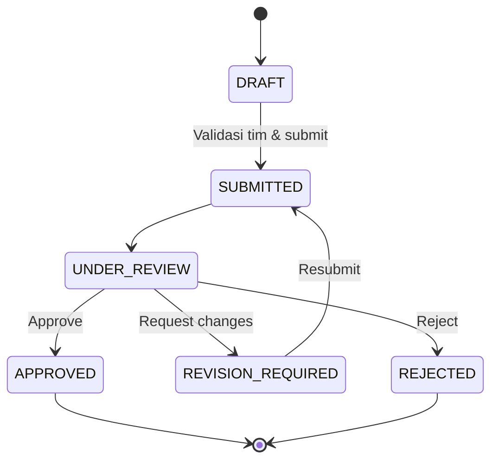
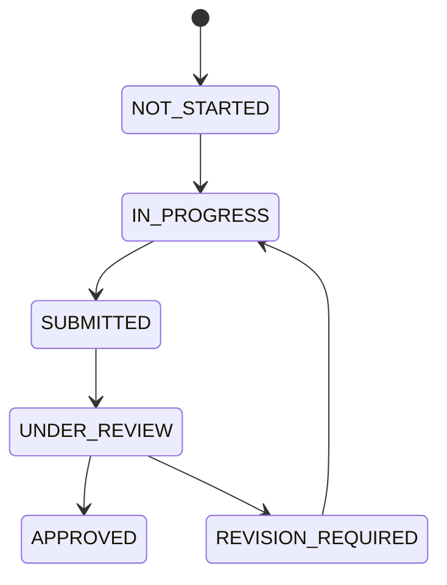
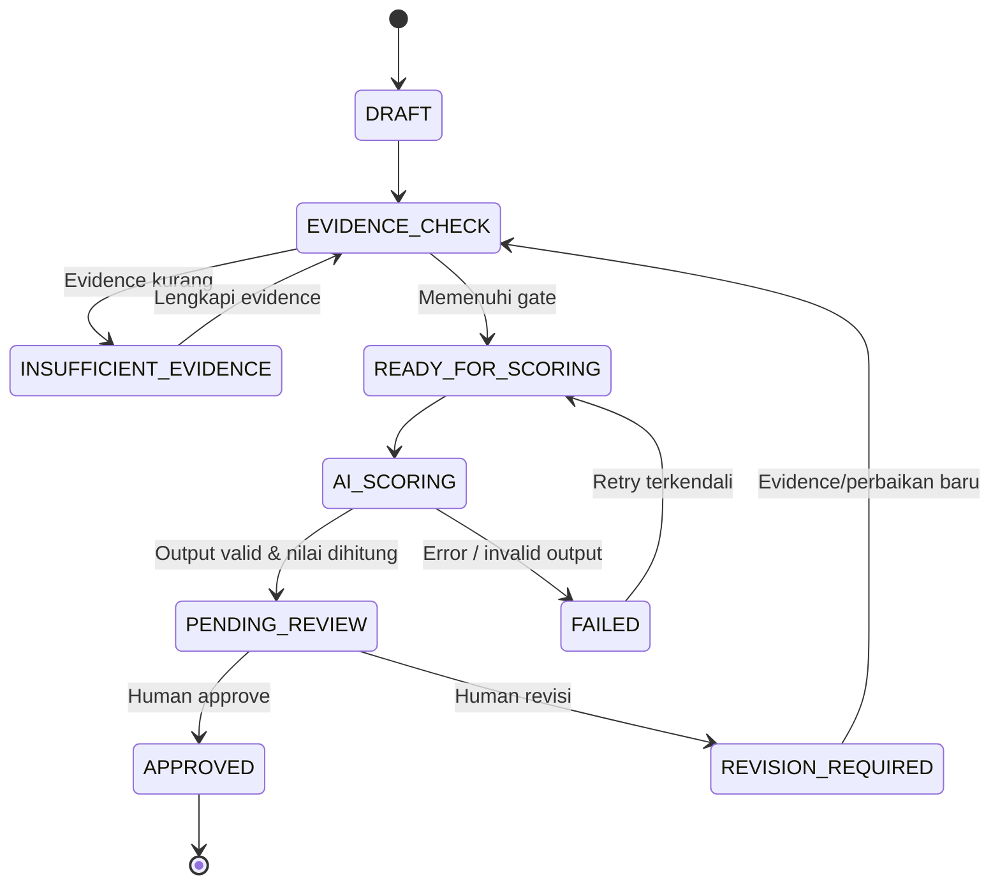

# Workflow, Role-Based Access Control & Approval

## 1. Lima role resmi [BRD]

1. **Super Admin:** role/permission, master, rubrik, konfigurasi, audit.
2. **Owner QCC:** kelola program, monitoring seluruh proyek, review/approval/scoring, penugasan reviewer.
3. **Mentor:** hanya proyek binaan, feedback/mentoring, approval sesuai assignment.
4. **Team Leader:** anggota tim/proposal/8 Step/bi-weekly/mentoring report/action/evidence.
5. **SIMer / Member:** profil/kompetensi, membuat proposal, proyek tim sendiri, kontribusi dan evidence.

`Reviewer/Approver` adalah **assignment + permission**, bukan role keenam bawaan. Super Admin tidak otomatis diposisikan sebagai reviewer proyek; izin harus eksplisit. Semua route memakai backend Policies yang memeriksa role + project membership/assignment.

## 2. Permission naming (usulan)

`users.manage`, `roles.manage`, `organizations.manage`, `competencies.manage`, `competencies.verify`, `batches.manage`, `rubrics.manage`, `rubrics.publish`, `projects.viewAny`, `projects.view`, `projects.create`, `projects.update`, `projects.submit`, `projects.review`, `projects.approve`, `teams.manage`, `teams.match`, `teams.confirm`, `steps.update`, `steps.review`, `biweekly.manage`, `biweekly.review`, `mentoring.manage`, `mentoring.review`, `evidence.upload`, `evidence.view`, `evidence.delete`, `actions.manage`, `risks.manage`, `scoring.run`, `scoring.view`, `scoring.review`, `scoring.approve`, `audit.view`, `notifications.view`.

**Konvensi:** setiap permission mencakup aksi saja; project scope selalu diverifikasi terpisah. `scoring.view` tidak otomatis diberikan kepada Mentor, Leader, Member.

## 3. Matriks akses baseline

| Modul / aksi | Admin | Owner QCC | Mentor | Leader | Member |
| --- | --- | --- | --- | --- | --- |
| Kelola akun/role/master | Ya | Sesuai delegasi | Tidak | Tidak | Tidak |
| Isi profil + kompetensi sendiri | Ya | Ya | Ya | Ya | Ya |
| Verifikasi level kompetensi | Bila ditugaskan | Bila ditugaskan | Bila ditugaskan | Tidak | Tidak |
| Buat proposal | Sesuai permission | Sesuai permission | Sesuai permission | Ya | Ya |
| Review/approve proposal | Izin eksplisit | Ya | Jika ditugaskan | Tidak tanpa izin | Tidak |
| Jalankan AI matching | Sesuai izin | Ya | Tidak | Ya bila assignment | Tidak secara default |
| Konfirmasi tim | Sesuai izin | Ya | Tidak | Bila diizinkan | Tidak |
| Input progress/evidence | Admin operasional | Pantau / edit berizin | Bina proyek sendiri | Ya | Tim sendiri, sesuai izin |
| Mentoring report/review | Sesuai izin | Pantau | Ya, proyek binaan | Submit/tindak lanjut | Lihat sesuai izin |
| AI scoring view/run | Ya, bila authorized | Ya | **Tidak default** | **Tidak default** | **Tidak default** |
| Approve final score | Jika mendapat approval grant | Ya/reviewer ditugaskan | Tidak default | Tidak default | Tidak default |
| Audit history | Global authorized | Sesuai scope | Historis projek relevan | Histori proyek relevan | Histori aktivitas sendiri |

Matriks adalah **rekomendasi**, finalisasi bersama Owner QCC/IT termasuk siapa verifikator, reviewer step, dan siapa yang dapat mengonfirmasi tim.

## 4. State machine proposal

Simpan setiap perpindahan di `review_decisions` dan `audit_logs`. Permintaan review tak boleh menciptakan dua final approval. `REJECTED` boleh diselesaikan dengan proposal baru atau revisi jika kebijakan memungkinkan [KONFIRMASI].

## 5. 8 Step QCC

- Eight steps adalah proses **di dalam** business-process point 6; *bukan* proses bisnis 1–8.
- Apakah step wajib berurutan dan apakah perlu approval tiap step **belum final** dalam BRD; default UX tampil berurutan, backend jadikan configurable policy setelah sign-off.
- Bi-weekly & mentoring dapat terjadi berulang saat proyek berlangsung, tidak diletakkan sesudah step 8 sebagai alur linear yang memaksa.

## 6. Scoring state machine

- Jangan langsung `AI_SCORING -> APPROVED`.
- `INSUFFICIENT_EVIDENCE` tidak sama dengan angka nol.
- `APPROVED` immutable; koreksi berikutnya adalah versi/rerun dan decision baru berdasarkan kewenangan.
- Review keputusan menyimpan komentar, skor reviewer (jika ada perubahan), skor final dan approver ID/waktu.

## 7. Assignment & row-level scoping

- `project_members` menghubungkan user dengan proyek; `role_in_project` `LEADER/MEMBER` bukan pengganti global role.
- `project_mentors` menghubungkan mentor dan proyek. `review_assignments` untuk target project/scoring/rubric tertentu, masa berlaku, permission scope.
- `Policy::view($user,$project)` memeriksa Owner/global scope atau membership/mentor assignment.
- Akses download evidence selalu mengikuti `Policy::viewEvidence`, tidak hanya cek apakah punya URL.
- Semua list membatasi query **sebelum** search/sort/pagination.

## 8. Audit & concurrency

- Catat actor ID, action, subject type/id, before/after yang sudah direduksi (jangan simpan secrets), alasan, IP jika disetujui, trace ID, timestamp.
- Gunakan transaction + optimistic locking (`lock_version`) untuk review, assignment dan edit komposisi tim; `lockForUpdate()` saat konfirmasi anggota; revalidasi di transaksi.
- Idempotency key untuk submit/scoring agar klik ganda tidak menggandakan record/job.

## 9. Pemberitahuan

- Trigger: proposal submitted/revision/approved/rejected; mentoring assigned; overdue action; scoring completed/pending review; final decision.
- Notifikasi menampilkan teks aman; tidak memaparkan nilai skor pada recipient tanpa `scoring.view`.
- In-app notification baseline; email opsional menunggu kebijakan perusahaan.
