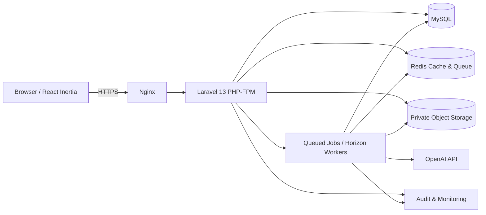

# Arsitektur Aplikasi & Kontrak Modul

## 1. Deployment target (rekomendasi)



- **UI:** React TypeScript rendered via Inertia, shadcn Base UI, Tailwind CSS 4, Poppins.
- **Backend:** Laravel 13 dengan session auth web starter kit, Policies, FormRequests, services/actions/jobs.
- **Database:** MySQL/InnoDB relational, indeks & transaksi untuk workflow.
- **Queue/Cache:** Redis, Horizon untuk job AI/extraction/notification; worker terpisah dari PHP-FPM.
- **Storage:** private local untuk dev, object storage compatible-S3 untuk staging/prod. Tidak letakkan evidence di folder `public/`.
- **OpenAI:** hanya backend/worker, tidak pernah dipanggil langsung client; API key di secret manager/env.
- BRD mengusulkan stack Google/Firebase/Gemini sebagai **opsi arsitektur awal**; stack ini merupakan **adaptasi yang dipilih user**, masih perlu approval IT/data governance.

## 2. Struktur folder usulan

```text
app/
  Enums/{ProjectStatus,StepStatus,ScoringStatus,ReviewDecision}.php
  Http/Controllers/{Dashboard,Profile,Competency,Proposal,Team,Step,Biweekly,Mentoring,Evidence,Scoring,Review,Admin}/
  Http/Requests/{StoreProposalRequest,ConfirmTeamRequest,UploadEvidenceRequest,ApproveScoringRequest,...}.php
  Http/Resources/{ProjectRowResource,ScoringResultResource,...}.php
  Models/{Project,ProjectMember,MemberCompetency,...}.php
  Policies/{ProjectPolicy,EvidencePolicy,ScoringPolicy,...}.php
  Actions/{Projects,Teams,Steps,Reviews,Scoring}/
  Services/{TeamRuleValidator,OpenAiClient,WeightedScoringCalculator,EvidenceResolver}/
  Jobs/{RunTeamMatching,ScanEvidence,ExtractEvidence,GeneratePreview,RunAiScoring,SendNotifications}/
  Events/{ProposalSubmitted,StepReviewed,ScoringApproved}/
  Notifications/
resources/js/
  components/ui/            # generated shadcn Base UI
  components/shared/{page-header,data-table,row-actions,date-picker,upload-field,empty-state,confirm-dialog}/
  layouts/{app-layout,auth-layout}/
  pages/{dashboard,profile,competencies,proposals,teams,projects,biweekly,mentoring,evidence,scoring,approval,admin}/
  types/{auth,project,table,scoring}.ts
  hooks/{use-debounced-filter,use-permission}.ts
routes/web.php
routes/console.php
```

Folder contoh disesuaikan dengan struktur aktual Laravel React Starter Kit, jangan menganggap template menghasilkan semua komponen di atas otomatis.

## 3. Page/route mapping baseline

| URI | Inertia page | Hak minimal |
| --- | --- | --- |
| `/dashboard` | Dashboard/Index | authenticated |
| `/profile` | Profile/Edit | own profile |
| `/competencies` | Competencies/Index | own competencies |
| `/proposals` | Proposals/Index | projects.viewAny (scoped) |
| `/proposals/create` | Proposals/Create | projects.create |
| `/proposals/{project}/edit` | Proposals/Edit | projects.update + project scope |
| `/proposals/{project}` | Proposals/Show | projects.view + project scope |
| `/teams/{project}` | Teams/Edit | teams.manage + scope |
| `/projects/{project}/steps/{step}` | Projects/Steps/Show | projects.view + scope |
| `/projects/{project}/biweekly` | Biweekly/Index | biweekly scoped |
| `/projects/{project}/mentoring` | Mentoring/Index | mentor/team assignment |
| `/projects/{project}/evidence` | Evidence/Index | evidence.view + scope |
| `/projects/{project}/scoring` | Scoring/Index | scoring.view + scope |
| `/approval` | Approval/Inbox | explicit assignment |
| `/admin/users` | Admin/Users/Index | users.manage |
| `/admin/organizations` | Admin/Organizations/Index | organizations.manage |
| `/admin/competencies` | Admin/Competencies/Index | competencies.manage |
| `/admin/batches` | Admin/Batches/Index | batches.manage |
| `/admin/rubrics` | Admin/Rubrics/Index | rubrics.manage |
| `/admin/audit` | Admin/Audit/Index | audit.view |

Setiap internal page memakai komponen shared `PageHeader` (Breadcrumb, H1, Description, Actions); jangan membangun heading sendiri-sendiri.

## 4. Service/Action responsibilities

- `ProjectService`: draft, validate, submit, revision, proposal status transitions.
- `TeamRuleValidator`: validator murni aturan 5/1/2/no duplicate dan kandidat eligible.
- `TeamMatchingService`: filter candidates + dispatch AI job + validate output; tidak langsung mengubah project_members.
- `TeamConfirmationAction`: transaction + lock; confirm membership, audit, notifikasi.
- `QccStepService`: initialize 8 steps, update progress, submit/review.
- `MonitoringService`: bi-weekly, mentoring, action/risk state.
- `EvidenceService`: upload, metadata, scan/process state, versioning, signed access.
- `ScoringOrchestrator`: evidence gate → async job → schema validation → Laravel weighted calc → review wait.
- `ReviewService`: authorization, state transition, reason, audit; scoring final approval.
- `AuditService`: append log with correlation IDs, scrubbing PII.

### API/controller pattern

- Read operations use Eloquent query scopes filtered by authorized user **before** paginate.
- Mutation: FormRequest validation, policy check, service/action transaction, audit, dispatch event after commit, redirect with flash/response.
- Inertia forms expose validation errors; server returns canonical status and the minimal fields needed for UI.
- Long-running AI/file processing returns job ID or scoring-run ID immediately, UI polls scoped endpoint at modest interval or uses approved broadcasting. Jobs must be idempotent.

## 5. Transaction, consistency & idempotency

- `ConfirmTeamAction` checks BR-01..05 while holding appropriate locks; AJAX validation alone not authoritative.
- `ApproveScoringAction` fetches pending run, verifies grant, revalidates immutable rubric/score, updates final values & audit in a single DB transaction.
- Event/notifications dispatch `afterCommit()`, not before a transaction is committed.
- Scoring run and matching run have idempotency key/request hash. Retries don't multiply final records.
- Storage upload and DB update are not one ACID transaction: apply compensating cleanup job for orphan files and failed records.

## 6. Security

- Session-based Laravel auth, CSRF token, secure HttpOnly cookies, rate limit auth and sensitive endpoints.
- All resource endpoints gated via Policies, not just middleware role. Default deny for evidence/scoring.
- Audit unexpected 403 probes and scoring download attempts; do not log raw API keys/personal file contents.
- Files: sniff MIME/signature, antivirus if available, random object keys, no trust original filename, short-lived access.
- OpenAI prompts treat uploaded docs as untrusted data; do not execute instructions inside evidence.
- Service credentials not exposed to Inertia props or browser. Use env/secret manager only.
- Confirm employee document/data transfer to OpenAI (privacy, DPA, region, retention) with IT/legal before go-live.

## 7. Operations, observability & rollout

- Environments `local`, `staging`, `production` with separate keys/storage/db.
- Structured logs with trace ID for request and AI job, queue metrics, slow queries, exception monitoring, upload/scoring success rate.
- Worker queues: `critical`, `default`, `files`, `ai`; set separate concurrency/timeouts/rate limits, retry/backoff and dead-letter resolution.
- Horizon dashboard privileged and non-public. Supervisors restart workers on deploy.
- Backup DB + object storage + restore drill, signed links expire, logs retention and RPO/RTO policy before go-live.
- Deployment: migrations safe / backward compatible, run smoke tests, warm relevant cache, restart workers, ability to rollback code.

## 8. Scope limit

- Internal operational dashboard, counts, basic notifications are supportive features **inside scope 1–9**.
- Executive report engine, advanced export, cross-company scoring report distribution and Convention ranking/award are **deferred**, except scoring type Convention itself if approved in scope.
