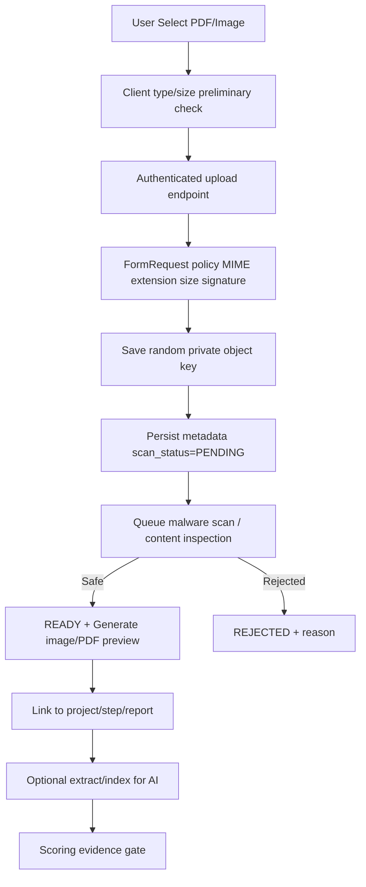

# File Management, Evidence Repository & PDF Processing

## 1. Tujuan

Mendukung upload evidence ke proposal, 8 Step QCC, bi-weekly, mentoring, action, dan scoring, termasuk **PDF yang ukuran lazimnya mulai 10 MB**. Pastikan upload tidak mengunci aplikasi dan berkas privat tidak bisa dilihat user lain.

## 2. Kebijakan ukuran (usulan, belum disahkan BRD)

- Baseline aplikasi **50 MiB per PDF** (konfigurasi bisa diubah per tenant/batch; bukan batas resmi BRD).
- PHP `upload_max_filesize=50M`, `post_max_size=64M` dan Nginx `client_max_body_size 64M` sebagai titik awal; tes end-to-end reverse proxy + load balancer + object storage; konsistensikan unit MB/MiB.
- Jika ditemukan evidence lebih besar, pertimbangkan object-storage direct multipart upload melalui signed upload endpoint dengan backend finalize, bukan menaikkan PHP memory/timeout tanpa desain.
- Jangan mengasumsikan PDF 50 MiB dapat langsung dikirim ke OpenAI dalam satu request. Batas input file bergantung endpoint/model/provider dan dapat berubah; split/extract/reduce content secara aman.

## 3. Kategori Evidence [BRD]

- Proposal attachment / dokumen pendukung.
- Evidence per 8 Step QCC (PDF, foto, grafik, dokumen).
- Bi-weekly meeting minutes (MoM), dokumentasi meeting, plan vs actual.
- Mentoring report dan bukti tindak lanjut.
- Tautan materi eksternal dan percakapan AI + summary.
- Evidence untuk AI scoring (mengacu pada dokumen yang sudah diunggah, **jangan menggandakan upload**).

Tipe yang diizinkan (initial suggestion): `application/pdf`, `image/png`, `image/jpeg`, docx, xlsx; text/CSV bila bisnis memerlukan. Mime allowlist final oleh IT.

## 4. UX upload modern (React + shadcn)

- Label `Lampiran Evidence` + **required star merah** jika wajib, dan placeholder/hint `Pilih atau tarik file ke sini`.
- Drag/drop zone rapi (border dashed tipis), `UploadCloud` icon Lucide, tombol `Pilih File`.
- Pratinjau **gambar** thumbnail before-submit, **PDF** icon + nama/ukuran/jumlah halaman (jika tersedia) + `Lihat PDF` modal viewer, file office ikon/metadata (opsional preview bila service tersedia).
- Per file: nama, MIME, size, upload %, `X` remove sebelum submit, cancel saat upload, retry failed, scan status, server error.
- Preview after-upload hanya via policy-checked short-lived URL atau streaming authenticated route. Hindari mengirim file sebagai base64 Inertia props.
- Empty, uploading, scanning, processing, ready, failed/rejected badge; icons `FileText`, `Image`, `ShieldCheck`, `CircleAlert`, `RefreshCw`, `X`.
- Sonner success hijau untuk upload accepted, warning oranye saat scan/analysis belum selesai, error merah untuk gagal. Tidak pernah memakai emoji.

## 5. Pipeline backend



- `UploadEvidenceRequest` validates project scope before receiving file; proof by authenticated user.
- Store original name as sanitized display metadata; object key random/hash prefix, never use original name as path.
- Scan PDF signatures and reject misleading extensions; no executable files; sanitize preview response `Content-Disposition`/CSP.
- `checksum_sha256` used for duplicate detection and extraction caching, not as authentication key.
- Optional EXIF removal of images according to privacy policy; preserve original if evidence requirements mandate authenticity, with access control.
- Store upload bytes *outside* MySQL; metadata records in `project_evidence`. Old versions should remain if used by scoring/audit.

## 6. PDF dan OpenAI

- Extract text first where feasible, retain page numbers/layout/source IDs; OCR only for scanned PDF when required and legal/quality criteria allow.
- Images, tables and charts may need vision/layout-capable processing; **text extraction alone does not preserve all evidence**.
- Use async worker; never parse heavy file inside user HTTP request.
- Cache extracted material by `(evidence_id, checksum, processing_version)`; evidence manifest stores status and source ref for reviewer.
- Chunk by pages/section, choose relevant content for rubric, limit token cost; disclosure when coverage partial.
- Sanitize file content as **untrusted**, prevent prompt injection, strict schemas and evidence reference validation.
- Approval depends on evidence quality, not file size.

## 7. Example Laravel validation and upload

```php
// FormRequest::rules() — contoh, tetap gunakan authorization() project policy.
return [
    'project_id' => ['required', 'integer', 'exists:projects,id'],
    'file' => ['required', 'file', 'mimes:pdf,jpg,jpeg,png,docx,xlsx', 'max:51200'],
    'title' => ['required', 'string', 'max:200'],
    'description' => ['nullable', 'string', 'max:5000'],
];
```

`max:51200` pada Laravel file rule berarti kibibytes (50 MiB). Pada produksi, tambahkan MIME sniffing+magic bytes, scan, auth, throttling, disk space/quota, error handling dan file transaction compensation.

```php
$storedPath = $request->file('file')->store('qcc/evidence', 'private');
// Buat record metadata dengan status PENDING_SCAN dan dispatch scan AFTER COMMIT.
```

Contoh `private` harus merupakan **filesystem disk yang didefinisikan** di `config/filesystems.php`, bukan disk bawaan yang otomatis tersedia.

## 8. Storage & access policies

- Default: private, no public `storage:link` for evidence; short-lived signed URL atau backend stream gated oleh Policy.
- User hanya bisa mengakses berkas proyek sendiri/assignment yang sah; scoring preview lebih ketat.
- Object versioning, backup/restore; checksum, metadata, uploader, times, audit, retention.
- Block delete/overwrite evidence referenced by immutable approved scoring. Gunakan superseding evidence version dan audit link.
- Export ZIP massal di luar scope proses 1–9; bila nanti diperlukan, via queue & expiring signed archive.

## 9. Test matrix evidence

| Kasus | Ekspektasi |
| --- | --- |
| PDF 10MB / 25MB / mendekati batas | Upload sukses dalam resource budget tes; status konsisten |
| Payload > max / salah MIME | 422 + inline error + toast merah |
| PDF corrupted/password protected | Reviewable error atau request clean file, jangan silent success |
| PDF berisi gambar/grafik | Tandai kemampuan extraction dan cakupan yang dianalisis |
| 2 upload nama sama | Object key berbeda, versioning tidak tertimpa |
| User luar proyek akses URL | 403/404, file bytes tidak bocor |
| File scan rejected | Tidak tersedia bagi scoring, alasan aman ditampilkan |
| User hapus evidence scored | Ditolak/versi baru, history scoring intact |
| Antrean AI sibuk | UI `QUEUED`, normal browsing tetap cepat |
